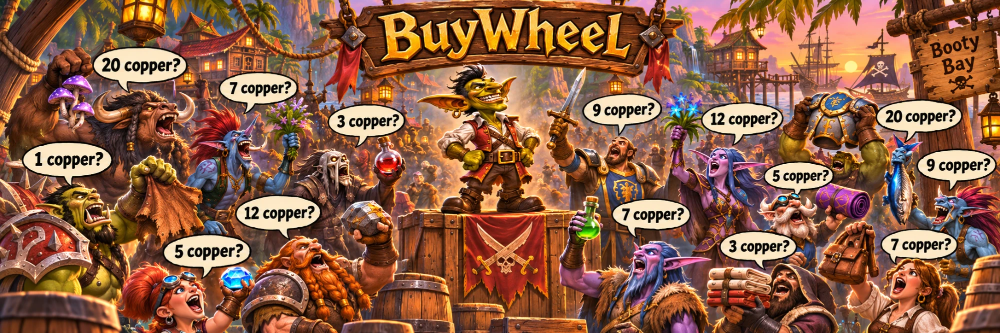
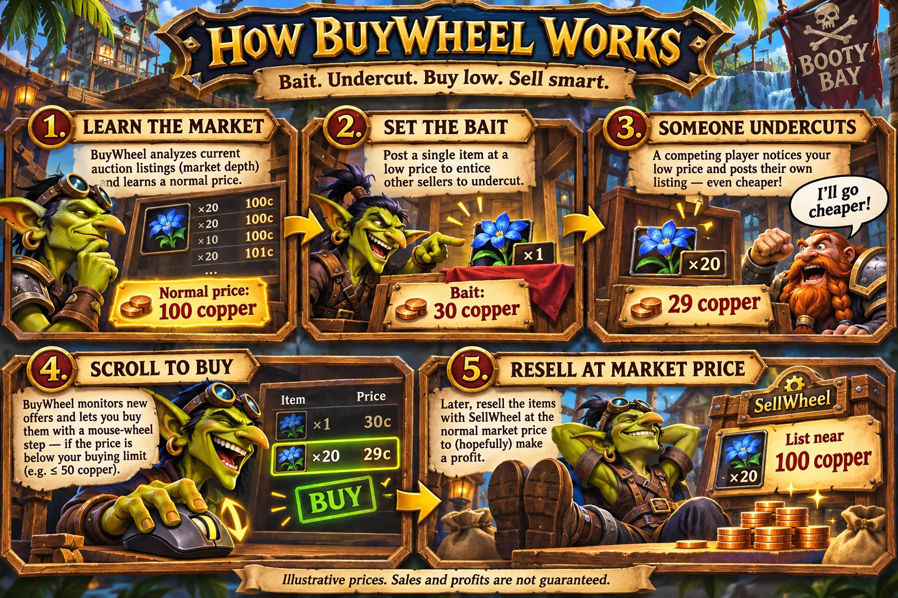

# BuyWheel

**Auction house tools for WoW Classic *Forever*:** bait, buy cheap with the mouse wheel, and sell with a clear price list.

[Install](#install) · [Let's go](#lets-go) · [Guide](docs/GUIDE.md) · [Every function](docs/FEATURES.md) · [Changelog](CHANGELOG.md)

---

## What it does

- **Learns** what an item normally costs, from the depth of the market.
- **Baits** with single items at low prices (by hand or automatically) and **buys** the undercut offers with the mouse wheel.
- **Sells** with a price list and a two-price split.
- Needs a real click or wheel step for every buy and post. Never acts on a timer.

| Tab | For |
|---|---|
| **BWS** | one item: max price, budget, bait, scroll to buy |
| **BWM** | many favorites: learned prices, limits, Auto-Bait, live profit |
| **SW** | selling: market price list, two prices, mouse-wheel sale |

## Install

**Windows, one file:**

1. Download **[UpdateBuyWheel.bat](https://raw.githubusercontent.com/ByteMeTwice/BuyWheel/main/UpdateBuyWheel.bat)** (right-click, *Save link as...*).
2. Double-click it. If Windows warns, click *More info*, then *Run anyway*.
3. Start the game (or `/reload`).

To **update**, run the same file again. Your saved data is not touched.

*Manually:* [download the ZIP](https://github.com/ByteMeTwice/BuyWheel/archive/refs/heads/main.zip), rename `BuyWheel-main` to `BuyWheel` and put it into `World of Warcraft\_forever_\Interface\AddOns`.

## Let's go

1. Mark your commodities as **favorites** in the auction house.
2. **BWM:** set *Max buy %* (e.g. 70), press **Start Learning Prices**, wait until it ends.
3. Check the items to watch, set the *Shared budget*, press **Start watching**, **scroll**.
4. **SW:** click an item in your bags, press **Sell**, scroll for the rest.

## More

- **[Guide](docs/GUIDE.md):** how BuyWheel works (normal price, limits, bait, profit, selling).
- **[Every function](docs/FEATURES.md):** what each button and field does, tab by tab.
- **[Technical reference](docs/REFERENCE.md)** and the **[changelog](CHANGELOG.md)**.

Prices and profits are estimates, not guarantees. Use it at your own responsibility and check your server's rules. Tests run with plain Lua 5.1 (`lua Tests/SellWheel.lua ./`). License: not specified yet.
