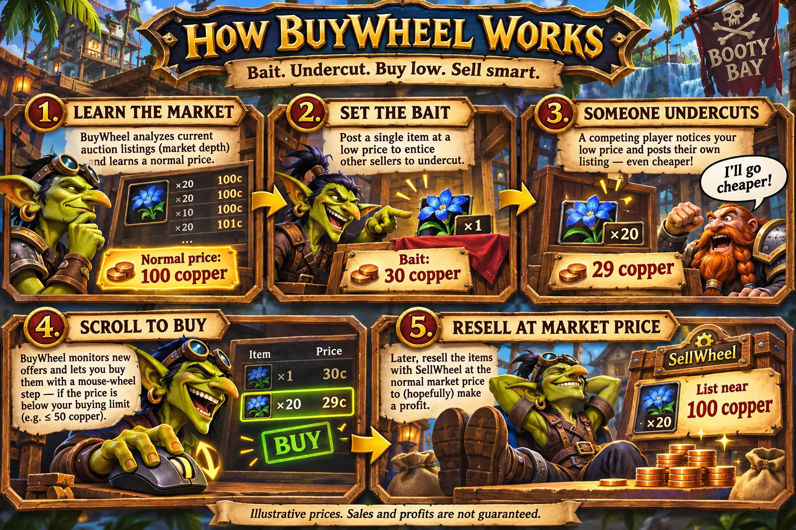

# BuyWheel guide

[Back to the overview](../README.md) · [Every function](FEATURES.md) · [Technical reference](REFERENCE.md)

How BuyWheel thinks, in plain words. For what each button does, see [FEATURES.md](FEATURES.md).

## The idea

1. **Learn** what an item normally costs (its *normal price*).
2. **Bait:** post a single item at a low price. Other sellers see it and undercut it.
3. **Buy** the undercut offers with the mouse wheel, as long as they are below your buying limit.
4. **Sell** the items again near the normal price (SellWheel).

Everything that buys or posts needs a real input from you (a click or a mouse-wheel step). The addon never buys or posts on a timer.

## The normal price

- It is measured from the **market depth**: the price at which the first 10% of the supply (at least 20 units) is reached, without your own listings. A thin bait listing at the very bottom cannot move it, and your own purchases barely do.
- It is deliberately **conservative**: of several measurements the lower quartile counts, and it never lies more than 5% above the median of the lowest prices.
- Where the measurements come from: **Start Learning Prices** (several depth queries per item), the listings the addon loads anyway before a purchase, SellWheel, and one automatic depth query per minute while watching.
- Between measurements the lowest price moves the value, within bounds.
- **Trust colors** in the favorites list: grey = fine, yellow = be careful (only the lowest price was measured, or the market is moving), red = old (no measurement for 10 minutes while watching).
- **Reset learned** deletes everything learned, so the next learning run is the only data in use.

## The buying limit

- **Limit = normal price × Max buy %.** Example: normal 100c at 70% means "buy up to 70c".
- With **Limit live** the limits follow the normal price while you watch. Without it a limit only changes when you run a learning run or edit it by hand.
- Per item you can still set a fixed **Max buy** by clicking the item name.

## What gets bought first

Every scan checks all watched items. Among the items under their limit the addon picks one by **weighted random draw** (Volume Trading, always on): the weight is the margin times the quantity listed (capped), so cheap high-volume items such as Copper Ore get their share and one big margin does not starve everything else.

## Bait

- A **bait** is one item posted at a low price (a percentage of the normal price, **Bait price**).
- **Manual:** the Bait button (BuyWheelS) and **Bait now** (BuyWheelM) post one bait. **Leave Bait** leaves one item at the lowest price instead of buying it all.
- **Auto-Bait** (BuyWheelM) posts baits for you, but only when the market is quiet and a mouse-wheel step is free. At most one own bait per item is up.
- **Material lasts [N] hours** is the only rate setting: the bait material in your bags is spread over N hours, the rate follows from the stock and the time left. Baits that could not be posted while the market was busy are saved up (about half an hour's worth) and used in the next quiet window.
- **Bait fingerprint:** every bait is posted at the nearest price that satisfies a fixed rule (from 2s up), so other BuyWheel users can recognize it. In the SellWheel table such offers are violet.
- Every bait writes one line to your chat. Baits show as negative amounts in the purchase history.

## Estimated profit

Each purchase counts "normal price × quantity − what you paid". A bait removes the expected resale value of the unit it uses and credits its set price when it sells. The figure is before auction house fees and deposits, and it is an estimate: nothing guarantees a sale.

## Selling

- **SellWheel** shows the market as a price list and proposes two prices: **Cheapest** (the first real level, without undercutting) and the **25% level** (just below the price where 25% of the supply is reached). Thin bait levels at the bottom are skipped.
- The quantity is split between them (default 50/50). **Sell** posts the first stage, the mouse wheel posts the rest.
- **Keep Bait Items** keeps that many items of every commodity out of the sale, so you can keep using them as bait.

## Tips for the first run

1. Mark your commodities as favorites in the normal auction house.
2. In BWM run **Start Learning Prices** once, with the auction house and the tab open. It ends by itself.
3. Check the items to watch, set the budget, **Start watching**, scroll.
4. After some time, look at the trust colors; yellow or red items need a fresh measurement.
5. Prices and profits are estimates. Use the addon at your own responsibility and check your server's rules.
